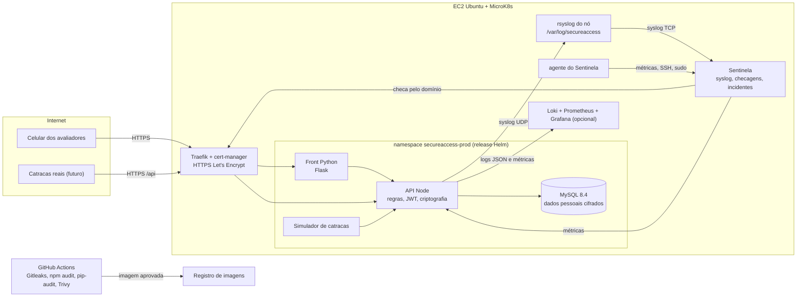

# SecureAccess City

Controle de acesso físico aos prédios públicos de uma cidade inteligente. Catracas e portas leem crachás ou digitais e perguntam a uma API se a pessoa pode entrar. A API decide, registra cada tentativa e transforma comportamentos suspeitos em alertas: força bruta na leitora, crachá clonado testado em vários prédios, crachá revogado, porta forçada, entrada de carona e sabotagem do leitor.

- **Front:** Python (Flask), painel do operador.
- **Back:** Node.js, API de controle de acesso.
- **Banco:** MySQL 8.4.
- **Implantação:** Kubernetes (MicroK8s na AWS) com chart Helm próprio, ambientes de homologação e produção.
- **Foco:** DevSecOps, com gestão de segredos, análise de dependências e auditoria (SIEM).
- **Monitoramento:** Sentinela, aplicação própria que recebe o syslog, checa o site por fora, acompanha o Kubernetes e o servidor e abre incidentes ([guia](docs/guia-sentinela.md)).

> Todos os nomes e documentos dos dados de demonstração são fictícios. Os documentos começam com `000` para deixar claro que não são CPFs reais.

## Equipe

Faculdade de Ciências Humanas – ESUDA · Pós-graduação em Segurança da Informação

Disciplina: Segurança em Nuvem e Desenvolvimento Seguro (DevSecOps) · Desafio Técnico 3 · material da disciplina: https://github.com/profclovesrocha/devops

- Ádrian Gabriel Ferreira da Silva
- Fernando Luiz Castro dos Santos Filho
- Ruan Angelo Oliveira Moura da Silva

## Por que criamos as aplicações

### SecureAccess City

- **Um problema real.** O Desafio 3 pedia uma aplicação publicada na AWS com Kubernetes e Helm, acessível por domínio e com syslog (Rocha, [2026]). Em vez de um exemplo genérico, escolhemos um risco concreto de cidade inteligente: o acesso físico a prédios públicos.
- **Registrar não basta.** Prédios como o data center, a sala de servidores e o centro de operações guardam serviços e dados críticos. É preciso decidir cada passagem na hora, perceber ataques (crachá clonado, força bruta na leitora, porta forçada) e proteger os dados pessoais de quem entra, inclusive a biometria, que a LGPD trata como dado sensível (Brasil, 2018, art. 5º, II).
- **As duas áreas juntas.** O tema une DevOps (ambientes, upgrade e rollback) e Segurança da Informação (segredos, dependências, auditoria e privacidade).

### Sentinela

- **Entender a aplicação.** O desafio pedia syslog. Ferramentas sugeridas, como Kiwi Syslog e Grafana, exibem os dados, mas não sabem o que é um crachá revogado ou uma rotação de chave atrasada. Queríamos transformar eventos em incidentes, como faz um SIEM.
- **Caber na mesma EC2.** Um pod leve, no lugar da pilha Prometheus, Loki e Grafana, numa máquina de 8 GB.
- **Aprender fazendo.** Construir coleta, normalização, correlação e alerta foi a forma de entender um SIEM por dentro (Kent; Souppaya, 2006).

## Estrutura

```
secureaccess-city/
├── api/                      API em Node.js (sem framework; só o driver mysql2)
│   ├── src/                  servidor, regras de acesso, JWT, criptografia, logs, simulador
│   ├── db/migrations/        esquema do MySQL (aplicado pela própria API)
│   ├── test/                 testes de integração (node --test)
│   └── Dockerfile
├── web/                      front em Python (Flask + gunicorn)
│   ├── templates/  static/   páginas, CSS e JS (sem CDN externa)
│   ├── tests/                testes (unittest)
│   └── Dockerfile
├── helm/secureaccess/        chart Helm
│   ├── Chart.yaml            dependência do subchart MySQL
│   ├── values.yaml           valores padrão, documentados
│   ├── values-staging.yaml   homologação
│   ├── values-prod.yaml      produção
│   ├── templates/            api, web, simulador, ingress, secret, networkpolicy, hpa, quota...
│   └── charts/mysql/         subchart do banco (StatefulSet + volume)
├── sentinela/                monitoramento e SIEM (Flask + SQLite): syslog, checagens, regras, painel
├── agente/                   agente Linux do Sentinela (systemd, sem root)
├── helm/sentinela/           chart Helm do Sentinela (RBAC só leitura, NodePort de syslog, volume)
├── observability/            rsyslog, logrotate e painel do Grafana (SIEM)
├── scripts/                  instalador da EC2, build com scan, deploy e demo de upgrade/rollback
├── .github/workflows/        pipeline DevSecOps (GitHub Actions)
├── docker-compose.yml        ambiente local completo
├── docs/guia-sentinela.md    guia de instalação e demonstração do Sentinela
├── docs/desastre-controlado.md  roteiro do upgrade que quebra e do rollback (1.0.0 → 1.1.0 → 1.1.1)
└── docs/relatorio-tecnico.md roteiro do relatório, com os problemas reais enfrentados
```

> Ao entregar no [repositório da disciplina](https://github.com/profclovesrocha/devops), renomeie a pasta e os arquivos conforme a convenção definida pelo professor em `desafios/`.

## Arquitetura



O navegador conversa só com o front. O front guarda o token da API numa sessão assinada (cookie HttpOnly) e chama a API de servidor para servidor, então nenhum JavaScript da página tem acesso ao token.

## Como os três pilares de DevSecOps foram atendidos

| Pilar | O que foi feito | Onde está |
|---|---|---|
| **Gestão de segredos** | Rotação obrigatória e automática das chaves que assinam os JWT (15 min em homologação, 60 min em produção), com `kid` no token: a chave antiga para de assinar, mas continua validando tokens já emitidos até expirarem. Rotação manual pelo painel. Segredos das chaves cifrados no banco com uma chave mestra (KEK) que vem do Secret do Kubernetes. Nome e documento dos cidadãos cifrados com AES-256-GCM por campo. Busca por documento via índice cego (HMAC). Senhas com scrypt. Tokens curtos. Cada pod recebe só os segredos de que precisa. | `api/src/keyring.js`, `api/src/crypto.js`, `helm/.../templates/secret.yaml`, tela **Segurança** |
| **Análise de dependências** | Pipeline que roda Gitleaks, testes, `npm audit`, `pip-audit` e Trivy no código antes de gerar a imagem. Depois, Trivy na imagem bloqueia a publicação se houver CVE alta ou crítica com correção. Gera SBOM (CycloneDX). Dependabot abre PRs de atualização. Versões fixadas, `npm --ignore-scripts`, imagens finais sem npm nem pip. | `.github/workflows/devsecops.yml`, `scripts/build-local.sh`, `.github/dependabot.yml` |
| **Auditoria (SIEM)** | Todo evento vira log JSON estruturado (`category`, `event`, porta, crachá, motivo), sem nomes de pessoas. Tentativas negadas, alertas de invasão e falhas de login também saem por syslog (RFC 5424, facility 13, "log audit") para o rsyslog do nó. Métricas Prometheus. Trilha de auditoria no banco (quem fez o quê, de onde). Painel Grafana pronto. | `api/src/services/`, `api/src/logger.js`, `observability/` |

Outros controles: NetworkPolicy (só a API fala com o banco), contêineres sem root e com sistema de arquivos somente leitura, sem token de service account montado, CSP sem `unsafe-inline`, proteção CSRF, bloqueio de conta após 5 senhas erradas, limitação de requisições, HSTS em produção, cota de recursos por namespace e Secret mantido mesmo após `helm uninstall` (sem ele os dados cifrados ficariam ilegíveis).

**Sobre "criptografia de ponta a ponta":** o tráfego é cifrado do celular ou da catraca até o cluster (TLS) e os dados pessoais ficam cifrados em repouso, com a chave fora do banco. Dentro do cluster, do Traefik até os pods, o tráfego é HTTP, isolado por NetworkPolicy. Para TLS também nesse trecho, o passo seguinte é um service mesh com mTLS (Linkerd ou Istio), que o próprio material da disciplina indica como estudo avançado.

## Rodar localmente

Com Docker instalado:

```bash
docker compose up --build
```

Painel em <http://localhost:8000>, usuário `admin`, senha `Admin@SecureAccess1` (só em desenvolvimento).

Testes automatizados, sem banco nem Docker:

```bash
cd api && npm test                                   # 18 testes da API
cd web && pip install -r requirements.txt && python -m unittest discover -s tests   # 13 testes do front
```

## Implantar no MicroK8s da AWS

### Instalação em um comando

Na EC2 (Ubuntu 24.04, pelo menos 4 GB de RAM, portas 80 e 443 liberadas no grupo de segurança e o domínio do DuckDNS apontando para o IP elástico), copie o projeto e rode:

```bash
sudo apt install -y unzip && unzip secureaccess-city.zip && cd secureaccess-city
bash scripts/instalar-ec2.sh meudesafio.duckdns.org seu@email.com
```

O instalador confere a máquina, ativa os addons do MicroK8s, instala Docker e Helm se faltarem, confere o DNS, cria o emissor de certificados, configura o rsyslog, gera e analisa as imagens, faz o deploy de produção e homologação com Helm e, no passo 9, sobe o Sentinela e o agente do servidor. No fim, mostra os endereços e as senhas. Pode ser executado de novo sem problema.

Opções: `SEM_STAGING=1` instala só a produção; `SEM_SENTINELA=1` pula o Sentinela; `SCAN=0` pula a análise de vulnerabilidades (só para destravar, e registre isso no relatório); o terceiro e o quarto argumentos definem os domínios da homologação e do Sentinela (padrão: `staging.` e `sentinela.` antes do domínio de produção).

As seções abaixo explicam o que o instalador faz, passo a passo, caso você prefira executar manualmente.

### Passo a passo manual

Pré-requisito: a VM já preparada, com MicroK8s, os addons `hostpath-storage ingress metrics-server cert-manager dashboard registry`, `kubectl` apontando para o cluster (`microk8s config > ~/.kube/config`) e o grupo de segurança liberando as portas 80 e 443.

### 1. Ferramentas na VM

```bash
sudo snap install helm --classic
curl -fsSL https://get.docker.com | sh
sudo usermod -aG docker $USER && newgrp docker
```

### 2. Código na VM

```bash
git clone https://github.com/<seu-usuario>/secureaccess-city.git
cd secureaccess-city
```

### 3. Gerar, escanear e publicar as imagens

```bash
bash scripts/build-local.sh 1.0.0
```

O script escaneia o código, gera as duas imagens, escaneia cada imagem e só envia para o registro local do MicroK8s (`localhost:32000`) se nada alto ou crítico for encontrado.

Na primeira vez, gere o `package-lock.json` para o build ficar reproduzível, e faça commit dele:

```bash
cd api && docker run --rm -v "$PWD:/app" -w /app node:22-alpine npm install --package-lock-only --ignore-scripts && cd ..
```

### 4. Emissor de certificados (uma vez por cluster)

```bash
cat <<EOF | kubectl apply -f -
apiVersion: cert-manager.io/v1
kind: ClusterIssuer
metadata:
  name: letsencrypt
spec:
  acme:
    server: https://acme-v02.api.letsencrypt.org/directory
    email: seu@email.com
    privateKeySecretRef:
      name: letsencrypt-key
    solvers:
      - http01:
          ingress:
            ingressClassName: traefik
EOF
```

### 5. Domínios

No DuckDNS, aponte `meudesafio.duckdns.org` para o IP elástico. Subdomínios como `staging.meudesafio.duckdns.org` normalmente resolvem para o mesmo IP; confira com `getent hosts staging.meudesafio.duckdns.org`. Se não resolver, crie um segundo subdomínio no DuckDNS para a homologação.

### 6. Deploy dos dois ambientes

```bash
bash scripts/deploy.sh staging staging.meudesafio.duckdns.org 1.0.0
bash scripts/deploy.sh prod meudesafio.duckdns.org 1.0.0
```

O script roda `helm lint`, `helm upgrade --install --wait`, o teste de fumaça (`helm test`) e mostra o histórico de revisões.

### 7. Senha do administrador

```bash
kubectl -n secureaccess-prod get secret sa-prod-secrets -o jsonpath='{.data.ADMIN_PASSWORD}' | base64 -d; echo
```

Os usuários `operador` e `auditor` têm senhas próprias no mesmo Secret (`OPERATOR_PASSWORD`, `AUDITOR_PASSWORD`).

### 8. Conferir

```bash
kubectl -n secureaccess-prod get pods,svc,ingress,hpa,networkpolicy
kubectl -n secureaccess-prod logs deploy/sa-prod-api | grep -E 'MIGRACAO_APLICADA|API_PRONTA'
kubectl -n secureaccess-prod get certificate
```

Abra `https://meudesafio.duckdns.org` no celular.

### Usando o GitHub Container Registry em vez do registro local

Com o pipeline publicando em `ghcr.io/<seu-usuario>`, troque o registro no deploy:

```bash
helm upgrade --install sa-prod ./helm/secureaccess -n secureaccess-prod --create-namespace \
  -f helm/secureaccess/values-prod.yaml --set ingress.host=meudesafio.duckdns.org \
  --set image.registry=ghcr.io/<seu-usuario> --set image.tag=<sha-curto>
```

Os pacotes do GHCR nascem privados. Torne-os públicos nas configurações do pacote ou crie um `imagePullSecret` e informe em `image.pullSecrets`.

## Syslog no nó (rsyslog)

Os valores de homologação e produção usam `api.syslog.mode: node`: a API envia os eventos de segurança por UDP para o rsyslog do próprio nó.

```bash
sudo install -d -o syslog -g adm -m 0750 /var/log/secureaccess
sudo cp observability/rsyslog-secureaccess.conf /etc/rsyslog.d/30-secureaccess.conf
sudo cp observability/logrotate-secureaccess /etc/logrotate.d/secureaccess
sudo systemctl restart rsyslog
sudo tail -f /var/log/secureaccess/seguranca.log
```

`eventos.log` recebe tudo; `seguranca.log` só negações, alertas e falhas. Não abra a porta 514 no grupo de segurança. Com o Sentinela ligado, o instalador troca a marca `@@ENCAMINHAR_SENTINELA@@` do arquivo por um encaminhamento TCP com fila para `<IP privado>:30514`.

## Sentinela (monitoramento e SIEM)

Segundo chart Helm do projeto, no namespace `sentinela`, com domínio próprio. Recebe o syslog da API (repassado pelo rsyslog) e do agente do servidor, checa produção e homologação pelo domínio público a cada 30 segundos, lê o Kubernetes com permissão só de leitura, raspa as métricas da API e abre incidentes por 27 regras (site fora do ar, pod em falha, disco cheio, rotação de chave JWT atrasada, força bruta no SSH ou no painel, porta forçada...). Avisos pelo Telegram são opcionais.

Instalação, conferência, roteiro de demonstração e solução de problemas: [docs/guia-sentinela.md](docs/guia-sentinela.md).

Para rodar localmente (sem Kubernetes): `cd sentinela && python3 app.py` (painel em `http://127.0.0.1:8080`, usuário `admin`, senha `Admin@Sentinela1`; syslog na porta 5514). Testes: `cd sentinela && python3 -m unittest discover -s tests`.

## Grafana, Loki e Prometheus (opcional)

```bash
microk8s enable observability
```

O addon instala Prometheus, Loki e Grafana no namespace `observability` e já coleta os logs de todos os pods. Em produção o chart cria um ServiceMonitor para as métricas da API.

1. Descubra a senha do Grafana: `kubectl -n observability get secret kube-prom-stack-grafana -o jsonpath='{.data.admin-password}' | base64 -d; echo` (o nome do Secret pode variar; liste com `kubectl -n observability get secrets`).
2. Acesse com um túnel, sem expor o Grafana na internet: `kubectl -n observability port-forward svc/kube-prom-stack-grafana 3000:80` e, no seu computador, `ssh -L 3000:localhost:3000 ubuntu@<ip>`.
3. Importe `observability/grafana-dashboard-siem.json` (Dashboards, Import) e escolha as fontes Loki e Prometheus.

O addon consome uns 2 GB de RAM. Se a VM ficar apertada, mantenha só produção e observabilidade, ou desligue o simulador da homologação.

## Demonstração de upgrade e rollback

### Desastre controlado (versões 1.0.0 → 1.1.0 → rollback → 1.1.1)

A versão 1.1 mostra o nome do dono do crachá na tela de alertas. O roteiro publica primeiro a 1.1.0, com um defeito que passa pelas sondas de saúde e pelo `helm test` mas quebra o painel para quem usa. O Sentinela detecta pelos logs, o `helm rollback` devolve a 1.0.0 e a 1.1.1 corrigida sobe em seguida.

```bash
bash scripts/desastre-controlado.sh preparar          # antes da apresentação: gera as imagens 1.1.0 e 1.1.1
bash scripts/desastre-controlado.sh executar prod     # ao vivo, com pausas entre as etapas
```

Roteiro completo, o que mostrar em cada etapa e o que vai para o relatório: [docs/desastre-controlado.md](docs/desastre-controlado.md).

### Upgrade de configuração

```bash
bash scripts/demo-upgrade-rollback.sh staging staging.meudesafio.duckdns.org
```

O roteiro mostra o histórico, faz um upgrade (rotação de 5 minutos e 2 réplicas da API), confere os pods, faz o rollback e mostra o histórico de novo. Banco e segredos não mudam no rollback.

Comandos avulsos úteis para os slides:

```bash
helm list -A
helm history sa-prod -n secureaccess-prod
helm get values sa-prod -n secureaccess-prod
helm diff upgrade ...            # se instalar o plugin helm-diff
helm rollback sa-prod 1 -n secureaccess-prod
```

## Se algo não funcionar

| Sintoma | O que fazer |
|---|---|
| Login volta para a tela de login sem erro | Acesse por `https://`. Em homologação e produção o cookie de sessão só trafega em HTTPS. |
| Certificado não sai (`kubectl get certificate` com READY `False`) | `kubectl describe certificate -n <namespace>`; confira o DNS do DuckDNS e se a porta 80 está aberta. |
| Site responde 502 ou 504 | Confira os pods (`kubectl get pods -n <namespace>`). Se estiverem prontos, teste sem as NetworkPolicies: `helm upgrade ... --reuse-values --set networkPolicy.enabled=false`. |
| API em `CrashLoopBackOff` | `kubectl logs deploy/<release>-api -n <namespace>`: o evento `CONFIGURACAO_INVALIDA` ou `INICIALIZACAO_FALHOU` diz o motivo. A API espera o MySQL por até 3 minutos. |
| Pods `Pending` | Falta de memória ou cota: `kubectl describe pod ...` e `kubectl describe resourcequota -n <namespace>`. |
| `ImagePullBackOff` | A imagem não está no registro: rode `bash scripts/build-local.sh` com a mesma tag do deploy. |
| Trivy não baixa a base de vulnerabilidades | O build já tenta três espelhos. Se todos falharem, espere alguns minutos e rode de novo. |
| A análise do Trivy barra o build | Leia o pacote e a versão corrigida que ele aponta e atualize a dependência ou a imagem base. Para destravar um deploy urgente, `SCAN=0`, e registre no relatório. |
| O domínio mostra outra página (ex.: "Welcome to nginx") | Outro Ingress responde pelo mesmo endereço: `kubectl get ingress -A`. Apague o que sobrou de testes antigos (`kubectl delete ingress <nome> -n <namespace>`) e abra o site numa aba anônima. |
| Instalador diz que o domínio não resolve | Passe só o nome (`meudesafio.duckdns.org`, sem `https://`) e confira no DuckDNS se o IP é o que o instalador mostra como "IP público desta máquina". |
| `permission denied` no Docker | Saia e entre de novo no SSH (grupo docker) ou rode com `DOCKER="sudo docker"`. |

## Usuários e perfis

| Usuário | Perfil | Pode |
|---|---|---|
| `admin` | Administrador | tudo: emitir, suspender, revogar e reativar crachás; rotacionar chaves; ver auditoria; simulador (só em homologação) |
| `operador` | Operador | acompanhar o painel, tratar alertas, suspender crachás |
| `auditor` | Auditor | ver tudo, incluindo chaves e trilha de auditoria, sem alterar nada |

## API

Rotas de operador exigem `Authorization: Bearer <token do login>`. Rotas de catraca exigem o token obtido em `/api/devices/token`.

| Método e rota | Quem | Para quê |
|---|---|---|
| `GET /healthz`, `GET /readyz` | público | sondas do Kubernetes |
| `GET /api/info` | público | versão e ambiente |
| `POST /api/auth/login` | público | login do operador (bloqueia após 5 erros) |
| `POST /api/auth/refresh`, `GET /api/auth/me` | operador | renovar token, ver sessão |
| `POST /api/devices/token` | catraca | autenticar o equipamento com o segredo dele |
| `POST /api/access/validate` | catraca | `{"method":"CRACHA","credential":"SA-10001"}` ou `{"method":"BIOMETRIA","credential":"<template>"}` |
| `POST /api/devices/events` | catraca | reportar `PORTA_FORCADA`, `CARONA`, `PORTA_ABERTA_EXCEDIDO`, `SABOTAGEM` |
| `POST /api/devices/heartbeat` | catraca | sinal de vida |
| `GET /api/dashboard`, `GET /api/feed` | todos os perfis | painel ao vivo |
| `GET /api/events`, `GET /api/alerts` | todos os perfis | histórico com filtros |
| `POST /api/alerts/:id/ack`, `/resolve` | admin, operador | tratar alerta |
| `GET /api/citizens`, `POST /api/citizens` | todos / admin | listar e emitir crachás |
| `POST /api/citizens/:id/status` | admin, operador | suspender, revogar, reativar |
| `GET /api/doors`, `GET /api/buildings` | todos os perfis | equipamentos e prédios |
| `GET /api/security/keys`, `POST /api/security/keys/rotate` | admin, auditor / admin | chaves JWT |
| `GET /api/audit` | admin, auditor | trilha de auditoria |
| `POST /api/simulate` | admin | cenários de incidente (desligado em produção) |
| `GET /metrics` (porta 9464) | Prometheus | métricas, fora do ingress |

## Decisões e limitações conhecidas

- **API sem framework.** Roteamento, validação, JWT HS256, cabeçalhos de segurança e limitação de requisições usam só a biblioteca padrão do Node. A única dependência é o `mysql2`. Isso reduz a superfície de CVEs; a contrapartida é manter esse código, coberto pelos testes. Uma alternativa de mercado seria Fastify com `jose`.
- **Limite de requisições em memória.** Com várias réplicas, cada uma conta separado. Para algo mais rígido, mova o contador para o banco ou para um Redis.
- **Segredos das catracas derivados.** Cada porta tem o próprio segredo, derivado de uma chave mestra que o simulador também conhece. Em produção real, cada equipamento receberia um segredo único no provisionamento (ou certificado cliente, com mTLS).
- **Um nó só.** O volume do MySQL fica no disco da EC2 (`hostpath`). Se a instância for apagada, os dados vão junto; por isso o backup para o S3 (`backup.enabled=true`, usando o perfil IAM da EC2).
- **Testes sem MySQL real no desenvolvimento.** Os testes automatizados usam um dublê do banco em memória (SQLite embutido no Node), que lê o mesmo arquivo de migração. A primeira subida no cluster é a validação com o MySQL real: confira os logs `MIGRACAO_APLICADA` e `API_PRONTA`.
- **Subchart local.** Não rode `helm dependency update`: o subchart já está desempacotado em `charts/mysql`.

## Problemas, soluções e lacunas

### Problemas encontrados e soluções aplicadas

| Problema | Causa | Solução |
|---|---|---|
| MicroK8s não subia | t3.micro com 908 MB de RAM | m7i-flex.large (8 GB) e disco de 30 GB |
| `kubectl` tentava `localhost:8080` | kubectl instalado à parte, sem configuração | `microk8s config > ~/.kube/config` |
| Ingress de teste ignorado | classe inexistente; o MicroK8s usa Traefik | recriar com `--class=traefik` |
| Abria na VM, mas não no celular | grupo de segurança sem as portas 80 e 443 | liberar HTTP e HTTPS; SSH só do IP do operador |
| Base do Trivy não baixava | arquivo faltando no espelho `mirror.gcr.io` | baixar uma vez, tentando três espelhos |
| Trivy barrou o build do front | `certifi` 2026.7.22 com raízes da emSign comprometidas, severidade crítica (OSV, 2026) | atualizar para `certifi` 2026.10.19 |
| O próprio scanner foi atacado | versões do Trivy e tags do `trivy-action` adulteradas em março de 2026 (GitLab, 2026) | Trivy fixado na 0.69.3 e `trivy-action` na 0.35.0; nunca `latest` |
| `helm test --logs` falhava com o teste aprovado | o pod de teste era apagado antes da leitura dos logs | política `before-hook-creation` |
| Domínio mostrava a página do nginx | Ingress de teste antigo registrado no mesmo host | apagar o Ingress de teste: um host, um Ingress |
| Sentinela sem acesso às métricas da API | NetworkPolicy liberava um único namespace | lista `monitoringNamespaces` com `range` |
| Versão 1.1.0 passou no Helm e nas sondas, mas quebrou o painel | consulta pedia a coluna `nome_enc`, que não existe | `helm rollback` em 9 s e correção na 1.1.1 |

### Lacunas conhecidas

Levantadas numa auditoria interna em 24/10/2026, com base na ISO/IEC 27001:2022, na ISO/IEC 27002:2022, na ISO/IEC 27701:2025, na LGPD, no NIST CSF 2.0 (NIST, 2024), no CIS Controls v8.1 (CIS, 2024), no guia de hardening de Kubernetes da NSA e da CISA (2022) e no OWASP (2025a; 2025b).

| Lacuna | Prioridade | Referência | Como fechar |
|---|---|---|---|
| Sem backup testado | Alta | ISO/IEC 27002:2022, 8.13; CIS (2024), controle 11 | ligar o CronJob para o S3 e testar a restauração |
| Deploy pela VM sem rodar os testes (o que deixou a 1.1.0 passar) | Alta | ISO/IEC 27002:2022, 8.29 e 8.32 | rodar os testes no `build-local.sh` ou publicar só imagens do pipeline |
| Contas compartilhadas e sem MFA | Alta | ISO/IEC 27002:2022, 5.16 e 8.5; CIS (2024), 6.3 e 6.5 | contas individuais e MFA para administradores |
| Governança da LGPD: base legal, RIPD, retenção, direitos do titular e comunicação de incidentes | Alta | Brasil (2018), arts. 16, 18, 37 e 38; Brasil (2024) | documentar a base legal, o RIPD, o prazo de retenção e o plano de incidentes |
| Syslog sem autenticação e aberto a qualquer pod do cluster | Média | ISO/IEC 27002:2022, 8.15; Miao, Ma e Salowey (2009) | restringir a porta ao IP do nó e usar TLS |
| Um nó só e monitoramento na mesma EC2 | Média | ISO/IEC 27002:2022, 8.14 e 8.16 | checagem externa; mais nós numa produção real |
| Pod Security não obrigatório e sem NetworkPolicy de saída | Média | NSA e CISA (2022) | rótulos de Pod Security nos namespaces e regras de saída |
| GitHub Actions fixadas por tag e imagens sem assinatura | Média | OWASP (2025b), A03 e A08 | fixar por SHA e assinar as imagens |
| Sem sistema de gestão de segurança (SGSI) | Estrutural | ISO/IEC 27001:2022, cláusulas 4 a 10 | análise de riscos e Declaração de Aplicabilidade |

O projeto implementa controles técnicos alinhados à ISO/IEC 27002, mas não está "conforme a ISO/IEC 27001": essa norma certifica o sistema de gestão de segurança de uma organização, não uma aplicação isolada.

## Principal lição

**Estar no ar não é estar funcionando.** A versão 1.1.0 passou no `helm upgrade --wait`, nas sondas de saúde, no `helm test` e na checagem externa, e mesmo assim 30 de 30 acessos ao painel deram erro 500. O que protegeu o usuário foi o conjunto:

- **testes que ninguém pula:** com o pipeline obrigatório, a 1.1.0 seria reprovada antes de subir;
- **logs que alguém lê:** o `ERRO_INTERNO` chegou ao Sentinela com a causa exata em menos de um minuto;
- **rollback ensaiado:** imagens guardadas no registro, histórico do Helm e banco sem migração, com a volta em 9 segundos.

## O que mais chamou a atenção

- **O scanner foi atacado.** Em março de 2026, versões do Trivy e tags do `trivy-action` foram adulteradas (GitLab, 2026). Fixar versões vale também para as ferramentas de segurança.
- **O portão barrou o nosso próprio build.** O `certifi` do front trazia raízes da emSign com chaves comprometidas, e o Trivy travou a imagem (OSV, 2026). Foi a prova de que o pipeline funciona.
- **Tudo verde, sistema quebrado.** Helm, sondas e `helm test` aprovaram a 1.1.0. Só o log mostrou o erro.
- **Um bug de idioma.** `nome_enc` em vez de `name_enc`: português e inglês misturados no mesmo código derrubaram o painel.
- **Um Ingress esquecido.** O domínio mostrava o nginx de um teste antigo registrado no mesmo host.
- **Memória faz diferença.** Com 908 MB de RAM, a t3.micro não subia nem o Kubernetes; foi preciso uma máquina de 8 GB.

## Roteiro de demonstração (cerca de 5 minutos)

1. Abra o painel no celular, faça login e mostre as passagens chegando ao vivo.
2. Na homologação, abra **Simulador** e dispare **Força bruta** e **Porta forçada**. Mostre os alertas no painel.
3. No terminal, mostre os mesmos eventos no log estruturado e no rsyslog (`tail /var/log/secureaccess/seguranca.log`).
4. Em **Segurança**, rotacione a chave JWT e mostre que o painel continua funcionando (o token antigo segue válido até expirar).
5. Em **Crachás**, mostre o documento mascarado e explique a cifra por campo; revogue um crachá e mostre a negação seguinte.
6. Mostre o pipeline no GitHub Actions e o SBOM gerado. Para provar o bloqueio, num branch troque uma versão por outra vulnerável (por exemplo `requests==2.25.0` em `web/requirements.txt`) e mostre o job falhando antes do build da imagem.
7. Rode `scripts/demo-upgrade-rollback.sh` e mostre `helm history`.
8. Abra o Sentinela: os eventos do passo 2 já estão na página Segurança, e a porta forçada virou incidente. Derrube o painel de homologação (`kubectl -n secureaccess-staging scale deploy sa-staging-web --replicas=0`), espere o incidente "fora do ar", ligue de novo e mostre a resolução automática.


## Apresentação

Os slides da apresentação, com os vídeos do protótipo e do desastre controlado, são entregues à parte.

## Referências

Formato ABNT NBR 6023:2018. As citações ao longo deste README seguem o sistema autor-data (ABNT NBR 10520:2023).

- AQUA SECURITY. **Trivy documentation**. [S. l.]: Aqua Security, 2026. Disponível em: https://trivy.dev/. Acesso em: 2 nov. 2026.
- BRASIL. Autoridade Nacional de Proteção de Dados. **Resolução CD/ANPD nº 15, de 24 de abril de 2024**. Aprova o Regulamento de Comunicação de Incidente de Segurança. Diário Oficial da União: seção 1, Brasília, DF, 26 abr. 2024.
- BRASIL. **Lei nº 13.709, de 14 de agosto de 2018**. Lei Geral de Proteção de Dados Pessoais (LGPD). Brasília, DF: Presidência da República, 2018. Disponível em: https://www.planalto.gov.br/ccivil_03/_ato2015-2018/2018/lei/l13709.htm. Acesso em: 2 nov. 2026.
- CANONICAL. **MicroK8s documentation**. [S. l.]: Canonical, 2026. Disponível em: https://microk8s.io/docs. Acesso em: 2 nov. 2026.
- CENTER FOR INTERNET SECURITY. **CIS Critical Security Controls**: version 8.1. East Greenbush: CIS, 2024. Disponível em: https://www.cisecurity.org/controls/v8-1. Acesso em: 2 nov. 2026.
- DWORKIN, M. **Recommendation for block cipher modes of operation**: Galois/Counter Mode (GCM) and GMAC. Gaithersburg: NIST, 2007. (NIST SP 800-38D). DOI: 10.6028/NIST.SP.800-38D.
- GERHARDS, R. **The Syslog Protocol**. [S. l.]: IETF, 2009. (RFC 5424). DOI: 10.17487/RFC5424.
- GITLAB. **CVE-2026-33634**: Trivy ecosystem supply chain was briefly compromised. GitLab Advisory Database, 24 mar. 2026. Disponível em: https://advisories.gitlab.com/golang/github.com/aquasecurity/trivy/CVE-2026-33634/. Acesso em: 2 nov. 2026.
- INTERNATIONAL ORGANIZATION FOR STANDARDIZATION; INTERNATIONAL ELECTROTECHNICAL COMMISSION. **ISO/IEC 27001:2022**: information security, cybersecurity and privacy protection — information security management systems — requirements. Geneva: ISO, 2022.
- INTERNATIONAL ORGANIZATION FOR STANDARDIZATION; INTERNATIONAL ELECTROTECHNICAL COMMISSION. **ISO/IEC 27002:2022**: information security, cybersecurity and privacy protection — information security controls. Geneva: ISO, 2022.
- INTERNATIONAL ORGANIZATION FOR STANDARDIZATION; INTERNATIONAL ELECTROTECHNICAL COMMISSION. **ISO/IEC 27701:2025**: privacy information management systems — requirements and guidance. Geneva: ISO, 2025.
- JONES, M.; BRADLEY, J.; SAKIMURA, N. **JSON Web Token (JWT)**. [S. l.]: IETF, 2015. (RFC 7519). DOI: 10.17487/RFC7519.
- KENT, K.; SOUPPAYA, M. **Guide to computer security log management**. Gaithersburg: NIST, 2006. (NIST SP 800-92). DOI: 10.6028/NIST.SP.800-92.
- LONVICK, C. **The BSD syslog Protocol**. [S. l.]: IETF, 2001. (RFC 3164). DOI: 10.17487/RFC3164.
- MIAO, F.; MA, Y.; SALOWEY, J. **Transport Layer Security (TLS) transport mapping for Syslog**. [S. l.]: IETF, 2009. (RFC 5425). DOI: 10.17487/RFC5425.
- NATIONAL INSTITUTE OF STANDARDS AND TECHNOLOGY. **The NIST Cybersecurity Framework (CSF) 2.0**. Gaithersburg: NIST, 2024. (NIST CSWP 29). DOI: 10.6028/NIST.CSWP.29.
- NATIONAL SECURITY AGENCY; CYBERSECURITY AND INFRASTRUCTURE SECURITY AGENCY. **Kubernetes hardening guide**: version 1.2. Fort Meade: NSA, 2022. Disponível em: https://media.defense.gov/2022/Aug/29/2003066362/1/1/0/CTR_KUBERNETES_HARDENING_GUIDANCE_1.2_20220829.PDF. Acesso em: 2 nov. 2026.
- OSV. **GHSA-6q48-6c7w-9gw2**: certifi bundles emSign root CAs with compromised intermediate CA keys. [S. l.]: OSV, 20 out. 2026. Disponível em: https://osv.dev/GHSA-6q48-6c7w-9gw2. Acesso em: 2 nov. 2026.
- OWASP FOUNDATION. **OWASP Application Security Verification Standard 5.0.0**. [S. l.]: OWASP, 2025a. Disponível em: https://owasp.org/www-project-application-security-verification-standard/. Acesso em: 2 nov. 2026.
- OWASP FOUNDATION. **OWASP Top 10:2025**. [S. l.]: OWASP, 2025b. Disponível em: https://top10.owasp.org/2025/. Acesso em: 2 nov. 2026.
- PERCIVAL, C.; JOSEFSSON, S. **The scrypt password-based key derivation function**. [S. l.]: IETF, 2016. (RFC 7914). DOI: 10.17487/RFC7914.
- ROCHA, C. **devops**: Disciplina DevSecOps Tools. [S. l.]: GitHub, [2026]. Disponível em: https://github.com/profclovesrocha/devops. Acesso em: 7 nov. 2026.
- SOUPPAYA, M.; MORELLO, J.; SCARFONE, K. **Application container security guide**. Gaithersburg: NIST, 2017. (NIST SP 800-190). DOI: 10.6028/NIST.SP.800-190.
- SOUPPAYA, M.; SCARFONE, K.; DODSON, D. **Secure Software Development Framework (SSDF) version 1.1**. Gaithersburg: NIST, 2022. (NIST SP 800-218). DOI: 10.6028/NIST.SP.800-218.
- THE HELM AUTHORS. **Helm documentation**. [S. l.]: Cloud Native Computing Foundation, 2026. Disponível em: https://helm.sh/docs/. Acesso em: 2 nov. 2026.
- THE KUBERNETES AUTHORS. **Kubernetes documentation**. [S. l.]: Cloud Native Computing Foundation, 2026. Disponível em: https://kubernetes.io/docs/. Acesso em: 2 nov. 2026.
